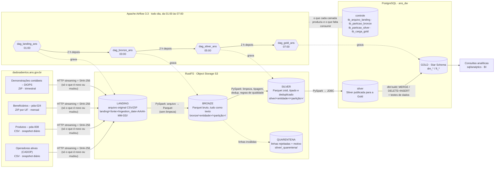
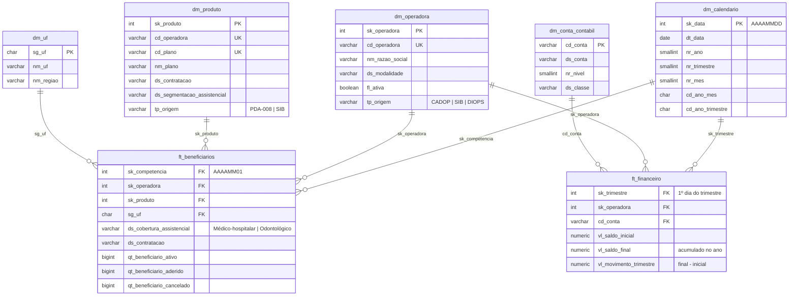
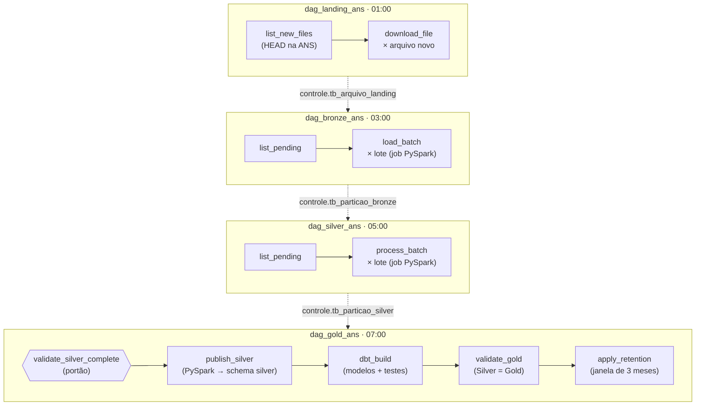

# ANS Lakehouse — Pipeline Medalhão (Landing · Bronze · Silver · Gold)

Pipeline de dados automatizado que ingere os **dados abertos da ANS** (Agência Nacional de Saúde
Suplementar), organiza-os em **Arquitetura Medalhão** e entrega um **Star Schema** pronto para BI,
com as consultas de **market share por modalidade/UF** e **sinistralidade por operadora/trimestre**.

| Componente | Tecnologia | Papel |
|---|---|---|
| Orquestração | **Apache Airflow 3.3** (LocalExecutor) | Quatro DAGs diárias, uma por camada: Landing 01:00, Bronze 03:00, Silver 05:00, Gold 07:00 |
| Object Storage | **RustFS 1.0** (API S3) | Camadas **Landing** (arquivo original), **Bronze** (Parquet bruto) e **Silver** (Parquet tratado) |
| Processamento | **PySpark 4.0** (Spark em modo local) | Bronze: arquivo → tabela Parquet; Silver: limpeza, tipagem, deduplicação, quarentena e qualidade; preparação da carga da Gold |
| Modelagem | **dbt 1.12** (dbt-postgres) | Gold: dimensões e fatos incrementais, contrato de tipos e chaves, testes de dados |
| Data Warehouse | **PostgreSQL 16** | Camada **Gold** (Star Schema) |

---

## Sumário

1. [Arquitetura](#1-arquitetura)
2. [Como executar do zero](#2-como-executar-do-zero)
3. [Camadas de dados](#3-camadas-de-dados)
4. [Orquestração (DAGs)](#4-orquestração-dags)
5. [Consultas analíticas finais](#5-consultas-analíticas-finais)
6. [Decisões de design](#6-decisões-de-design)
7. [Estrutura do repositório](#7-estrutura-do-repositório)
8. [Limitações e próximos passos](#8-limitações-e-próximos-passos)

---

## 1. Arquitetura

### Fluxo de dados



### Modelo dimensional (camada Gold)



### As quatro DAGs

Uma DAG por camada, todas diárias, de 2 em 2 horas a partir da 01:00 (horário de Brasília), com a TaskFlow API
como nos exemplos oficiais do Airflow. Elas não trocam XCom: cada uma registra o que produziu numa
tabela de controle e a seguinte consome o que ainda está pendente.



### Padrão de nomenclatura

Regra geral: nomes em português, em `snake_case`, minúsculos, sem acento e sem espaço. A exceção são as
tasks do Airflow, em inglês, como o resto da interface do Airflow.

**Camadas e arquivos (Object Storage)**

| Objeto | Padrão | Exemplo |
|---|---|---|
| Bucket | nome da camada | `landing`, `bronze`, `silver` |
| Fonte / entidade | substantivo no plural | `operadoras`, `produtos`, `beneficiarios`, `financeiro` |
| Partição | `chave=valor` (estilo Hive), do período para o detalhe | `competencia=202609/uf=SP` · `ano=2026/trimestre=2` · `data_snapshot=2026-11-09` |
| Arquivo na Landing | `<fonte>/ingestion_date=AAAA-MM-DD/[<partição>/]<nome original>` | `operadoras/ingestion_date=2026-11-09/Relatorio_cadop.csv` |
| Tabela na Bronze | `<entidade>/<partição>/<entidade>.parquet` | `beneficiarios/competencia=202609/uf=SP/beneficiarios.parquet` |
| Tabela na Silver | `tb_<entidade>/<partição>/tb_<entidade>.parquet` | `tb_financeiro/ano=2026/trimestre=2/tb_financeiro.parquet` |
| Quarentena | `_quarentena/tb_<entidade>/<partição>/rejeitados.parquet` | `_quarentena/tb_financeiro/ano=2026/trimestre=2/rejeitados.parquet` |

**Banco de dados (PostgreSQL `ans_dw`)**: toda tabela, da Silver em diante, começa com o prefixo de 2 letras do seu tipo: `tb_` (tabela), `dm_` (dimensão) ou `ft_` (fato).

| Objeto | Padrão | Exemplo |
|---|---|---|
| Schema | papel da camada | `controle`, `silver`, `gold`, `referencia` |
| Dimensão | `dm_<entidade no singular>` | `dm_operadora`, `dm_produto`, `dm_uf` |
| Fato | `ft_<assunto>` | `ft_beneficiarios`, `ft_financeiro` |
| Silver publicada no DW | `tb_<entidade>` | `silver.tb_operadoras`, `silver.tb_beneficiarios` |
| Tabela de referência (seed do dbt) | `tb_<entidade no plural>` | `referencia.tb_ufs` |
| Controle entre camadas | `tb_<objeto>_<camada que o produz>` | `tb_arquivo_landing`, `tb_particao_bronze`, `tb_particao_silver`, `tb_carga_gold` |
| Unidade de carga da Gold | `<tabela>:<período>` | `ft_beneficiarios:2026-09`, `ft_financeiro:2026-T2` |
| Modelo do dbt | o nome da tabela que ele cria | `dbt/models/gold/dm_operadora.sql` |
| Teste do dbt | a regra que ele confere | `ft_financeiro_movimento_do_trimestre.sql` |

**Colunas: o prefixo diz o tipo de dado**

| Prefixo | Significado | Tipo | Exemplo |
|---|---|---|---|
| `sk_` | chave substituta (*surrogate key*) da Gold | `integer` | `sk_operadora`, `sk_competencia` |
| `cd_` | código | texto ou inteiro | `cd_operadora`, `cd_plano`, `cd_conta` |
| `id_` | identificador numérico vindo da fonte | `bigint` | `id_plano` |
| `nr_` | número que não é código nem quantidade | inteiro ou texto | `nr_cnpj`, `nr_telefone`, `nr_ano` |
| `nm_` / `ds_` | nome / descrição | texto | `nm_razao_social`, `ds_modalidade` |
| `sg_` | sigla | `char` | `sg_uf`, `sg_uf_sede` |
| `tp_` | tipo, com poucos valores possíveis | texto | `tp_sexo`, `tp_origem` |
| `dt_` | data | `date` | `dt_competencia`, `dt_registro_ans` |
| `qt_` | quantidade | `bigint` | `qt_beneficiario_ativo` |
| `vl_` | valor em reais | `numeric(20,2)` | `vl_saldo_final`, `vl_movimento_trimestre` |
| `fl_` | indicador verdadeiro/falso | `boolean` | `fl_ativa`, `fl_odontologico` |
| `dh_` | data e hora | `timestamp` / `timestamptz` | `dh_processamento`, `dh_atualizacao` |

Toda coluna da Silver, da Gold e do schema `controle`, e as colunas de controle da Bronze, começam com um desses prefixos de 2 letras. A chave natural da operadora é
`cd_operadora` (o registro ANS) em todas as camadas, mesmo quando a ANS a chama de `CD_OPERADORA`,
`REGISTRO_OPERADORA` ou `REG_ANS`.

**Chaves e valores**

- Chave de data: inteiro `AAAAMMDD` (`sk_data`). Fatos mensais apontam para o 1º dia do mês
  (`sk_competencia`); fatos trimestrais, para o 1º dia do trimestre (`sk_trimestre`).
- Membro desconhecido nas dimensões: `sk = -1` (`cd_operadora = '000000'`, `cd_plano = 'NI'`).
- Período em texto: competência `AAAA-MM` (`2026-09`) e trimestre `AAAA-Tn` (`2026-T2`); nas partições,
  `AAAAMM` e `ano=AAAA/trimestre=n`.
- Ausência explícita em vez de nulo nas categorias: `NÃO INFORMADA`, `Não Identificado`; UF não
  identificada `XX`; sexo não informado `I`.
- Códigos com zeros à esquerda e largura fixa: registro ANS com 6 dígitos, CNPJ com 14 e CEP com 8.

**Orquestração e código**

| Objeto | Padrão | Exemplo |
|---|---|---|
| DAG | `dag_<camada>_<domínio>` | `dag_landing_ans`, `dag_gold_ans` |
| Task | inglês, `verbo_objeto` | `list_new_files`, `publish_silver`, `apply_retention` |
| Tag | fonte, domínio e camada | `ans`, `saude`, `gold` |
| Módulo Python | assunto, em português | `retencao.py`, `regras_silver.py` |
| Função Python | verbo no infinitivo + objeto | `listar_arquivos_novos()`, `publicar_silver()` |
| Script SQL | `NN_<conteúdo>.sql`, na ordem de execução | `sql/controle/01_controle.sql` |
| Variável de ambiente | maiúsculas, prefixo do componente | `ANS_MESES_RETENCAO`, `SPARK_DRIVER_MEMORY`, `DW_HOST` |

---

## 2. Como executar do zero

### Pré-requisitos

- Docker Engine/Desktop com **Docker Compose v2** (testado com Docker 29 / Compose 5).
- **8 GB de RAM** para o Docker (pico observado ~6 GB somando todos os containers) e ~5 GB de disco livre. Com
  menos memória, reduza `SPARK_DRIVER_MEMORY` no `.env` (o Spark passa a gravar mais em disco).
- Acesso à internet (`dadosabertos.ans.gov.br`). Uma competência completa baixa ~400 MB (todas as UFs).

### Passo a passo

```bash
# 1) Clonar o repositório
git clone <url-do-repositorio> ans-lakehouse-pipeline
cd ans-lakehouse-pipeline

# 2) (Opcional) customizar credenciais/portas. Sem .env, valem os padrões abaixo.
#    No Linux, defina AIRFLOW_UID com o seu `id -u`.
cp .env.example .env

# 3) Construir a imagem do Airflow (com Java 17, PySpark e dbt) e subir todo o ambiente
docker compose up -d --build

# 4) Aguardar todos os serviços ficarem "healthy" (~1-2 min)
docker compose ps
```

| Serviço | Endereço | Credenciais padrão |
|---|---|---|
| Airflow (UI/API) | http://localhost:8080 | `airflow` / `airflow` |
| RustFS (console) | http://localhost:9001 · API S3 em `localhost:9000` | `rustfsadmin` / `rustfsadmin123` |
| PostgreSQL – Gold | `localhost:5433`, banco `ans_dw` | `dw` / `dw` |

> Os buckets, schemas e tabelas são criados pelas próprias DAGs, de forma idempotente: buckets e
> controle na primeira tarefa da Landing, da Bronze e da Silver, o schema `silver` do PostgreSQL em `publish_silver` e o Star Schema pelo
> dbt em `dbt_build`. Não há passo manual de setup.

### 5) Executar o pipeline

As quatro DAGs são criadas pausadas. Despausadas, rodam todo dia: **Landing à 01:00, Bronze às
03:00, Silver às 05:00 e Gold às 07:00** (horário de Brasília). As 2 horas entre uma camada e a
seguinte sobram para uma noite normal, que só traz o que a ANS publicou na véspera.

```bash
for camada in landing bronze silver gold; do
  docker compose exec airflow-scheduler airflow dags unpause dag_${camada}_ans
done
```

> Ao despausar depois da 01:00, o Airflow roda imediatamente a execução agendada de hoje que
> ficou para trás. Na primeira vez, a Landing baixa a janela de retenção inteira: as 3 competências
> de beneficiários mais recentes publicadas (~400 MB por mês), o trimestre mais recente do DIOPS e
> os dois snapshots.

Para ver o pipeline funcionando sem esperar o horário agendado nem baixar a janela inteira, dispare uma
carga pequena e depois cada camada **quando a anterior terminar** (acompanhe na UI ou com
`airflow dags list-runs <dag_id>`). Cada uma leva de 1 a 2 min com este volume:

```bash
# 1) Landing: as 3 competências da janela só para AC e RR
docker compose exec airflow-scheduler airflow dags trigger dag_landing_ans \
    --conf '{"ufs": ["AC", "RR"]}'
# 2) Bronze, quando a Landing terminar
docker compose exec airflow-scheduler airflow dags trigger dag_bronze_ans
# 3) Silver, quando a Bronze terminar
docker compose exec airflow-scheduler airflow dags trigger dag_silver_ans
# 4) Gold, quando a Silver terminar
docker compose exec airflow-scheduler airflow dags trigger dag_gold_ans
```

Disparar fora de ordem é seguro: cada camada processa só o que a anterior já registrou, e se a Gold
rodar com algo ainda pendente o portão `validate_silver_complete` barra a carga sem gravar nada.
Pela UI: *Dags → dag_landing_ans → Trigger*, preenchendo os parâmetros no formulário.

> **Windows PowerShell 5.1** remove as aspas duplas de argumentos passados a executáveis; escape-as
> (`--conf '{\"ufs\": [\"AC\", \"RR\"]}'`) ou use o Git Bash / a UI.

### 6) Janela de retenção e reprocessamento

O lakehouse guarda só os períodos mais recentes publicados pela ANS: as **3 últimas competências de
beneficiários** e o **último trimestre do DIOPS** (hoje, jul a set/2026 e o 2º tri/2026). A janela é
móvel: quando a ANS publica um mês novo, a Landing o baixa e o mês mais antigo sai das quatro camadas.
Operadoras e produtos são cadastros (retrato atual) e ficam fora da regra.

A regra é aplicada em duas pontas ([`retencao.py`](src/ans_pipeline/retencao.py)):

- **Landing:** consulta 6 meses e 3 trimestres na ANS, porque a publicação atrasa, e só baixa o que
  cai na janela. Um mês que já saiu não volta a ser baixado, mesmo se a ANS o republicar.
- **Gold:** a última task, `apply_retention`, apaga o que saiu da janela da Gold, da Silver, da
  Bronze e da Landing, nessa ordem, junto com os registros de controle. Ela roda depois da carga,
  quando as quatro camadas estão consistentes.

O tamanho da janela vem de `ANS_MESES_RETENCAO` e `ANS_TRIMESTRES_RETENCAO` (padrão 3 e 1, no `.env`).

```bash
# Refazer uma camada inteira (ex.: depois de mudar uma regra de limpeza ou o modelo)
docker compose exec airflow-scheduler airflow dags trigger dag_bronze_ans --conf '{"reprocessar": true}'
docker compose exec airflow-scheduler airflow dags trigger dag_silver_ans --conf '{"reprocessar": true}'
docker compose exec airflow-scheduler airflow dags trigger dag_gold_ans --conf '{"reprocessar": true}'
```

| DAG | Parâmetros |
|---|---|
| `dag_landing_ans` | `ufs` (padrão: as 27 UFs e `XX`, a UF não identificada) |
| `dag_bronze_ans` | `reprocessar` (padrão `false`) |
| `dag_silver_ans` | `reprocessar` (padrão `false`) |
| `dag_gold_ans` | `reprocessar` (padrão `false`) |

### 7) Consultar a camada Gold

```bash
# Market share por modalidade em cada UF (última competência carregada)
docker compose exec -T dw-postgres psql -U dw -d ans_dw < sql/analytics/01_market_share_modalidade_uf.sql

# Sinistralidade por operadora e trimestre
docker compose exec -T dw-postgres psql -U dw -d ans_dw < sql/analytics/02_sinistralidade_operadora_trimestre.sql
```

No PowerShell: `Get-Content sql/analytics/01_market_share_modalidade_uf.sql | docker compose exec -T dw-postgres psql -U dw -d ans_dw`.
Qualquer cliente SQL/BI (DBeaver, Power BI, Metabase…) conecta em `localhost:5433`.

### 8) Testes automatizados

```bash
docker compose exec airflow-scheduler python -m pytest -q -p no:cacheprovider /opt/airflow/tests
```

Cobrem as regras da Silver, rodando numa sessão Spark local (tipagem, padronização, deduplicação,
quarentena, encoding, mudança de layout, lotes por período), janelas de verificação, URLs, chaves e
detecção de republicação da Bronze, a janela de retenção (quais períodos ficam, mês novo empurra o
mais antigo, mês expurgado não volta), a decisão do portão da Gold (Silver completa, arquivo
pendente, partição sem arquivo no storage) e a integridade das quatro DAGs (import, só as tarefas
previstas, horários em sequência, mapeamento por arquivo e por lote, portão antes de
qualquer carga, dbt depois da publicação da Silver, retenção por último, retries e parâmetros).

Os testes de dados da Gold são do dbt e rodam a cada carga, dentro de `dbt_build`. Para rodá-los à
parte ou gerar a documentação do modelo (linhagem e dicionário das tabelas):

```bash
docker compose exec airflow-scheduler bash -c 'cd /opt/airflow/dbt && $DBT_BIN test --profiles-dir .'
docker compose exec airflow-scheduler bash -c 'cd /opt/airflow/dbt && $DBT_BIN docs generate --profiles-dir . --target-path /tmp/dbt-docs'
```

### 9) Encerrar

```bash
docker compose down        # para os containers, mantém os dados
docker compose down -v     # apaga também os volumes (Bronze, Silver, Gold e metadados do Airflow)
```

---

## 3. Camadas de dados

### Fontes

| Tema do case | Dataset ANS | Formato / periodicidade | Volume aproximado |
|---|---|---|---|
| Operadoras | Relatório do Cadastro de Operadoras Ativas (CADOP) | CSV `;` · snapshot diário | ~1,1 mil linhas |
| Produtos | Características dos produtos da saúde suplementar (pda-008) | CSV `;` · snapshot diário | ~166 mil planos, 75 MB |
| Beneficiários | Informações consolidadas de beneficiários (pda-024) — a base que alimenta o *Caderno de Informação da Saúde Suplementar* | ZIP com CSV, **um por UF**, mensal | ~400 MB zip / ~12 milhões de linhas por mês (SP ≈ 5 mi) |
| Financeiro | Demonstrações contábeis (DIOPS) | ZIP com CSV, trimestral | ~700 mil linhas por trimestre |

### Landing — `s3://landing` (arquivo original)

- O arquivo é baixado em streaming e gravado **byte a byte como publicado** (CSV ou ZIP).
- Navegação por **data de ingestão** (+ período de referência quando a fonte é periódica):

```text
landing/operadoras/ingestion_date=2026-11-07/Relatorio_cadop.csv
landing/produtos/ingestion_date=2026-11-07/pda-008-caracteristicas_produtos_saude_suplementar.csv
landing/beneficiarios/ingestion_date=2026-11-07/competencia=202609/pda-024-icb-SP-2026_09.zip
landing/financeiro/ingestion_date=2026-11-07/ano=2026/trimestre=2/2T2026.zip
```

- Cada objeto carrega metadados de linhagem: URL de origem, **SHA-256**, ETag e `Last-Modified` da
  ANS, instante da ingestão, `dag_id`/`run_id`/`task_id`. O download valida o `Content-Length`.
- **Só entra o que é novo ou mudou.** Antes de baixar, a DAG faz um `HEAD` em cada arquivo e compara
  a assinatura (ETag, data e tamanho) com a do último arquivo daquela partição. A ANS republica
  meses anteriores com frequência: um arquivo republicado vira um novo objeto, numa nova
  `ingestion_date`. Se o conteúdo baixado tiver o mesmo SHA-256 do anterior, nada é gravado.
- A Landing é *append-only*: versões anteriores ficam preservadas, cada uma na sua `ingestion_date`.

### Bronze — `s3://bronze` (Raw Zone)

O arquivo da Landing vira tabela, sem nenhuma limpeza ([`bronze.py`](src/ans_pipeline/bronze.py)). O
PySpark abre o ZIP, detecta o encoding (UTF-8 ou Latin-1), lê o CSV e grava Parquet com **todas as
colunas como texto**, exatamente como vieram. Só os nomes passam para `snake_case` sem acento, para o
Parquet aceitar. Uma partição por período, como na Silver; a versão nova de um arquivo sobrescreve a
partição.

```text
bronze/operadoras/data_snapshot=2026-11-10/operadoras.parquet
bronze/produtos/data_snapshot=2026-11-10/produtos.parquet
bronze/beneficiarios/competencia=202609/uf=SP/beneficiarios.parquet
bronze/financeiro/ano=2026/trimestre=2/financeiro.parquet
```

- Colunas de controle (UTC): `dh_ingestao` (quando o arquivo chegou à Landing), `ds_arquivo_origem` (objeto da Landing) e `dh_processamento` (quando a Bronze gravou a partição).
- A única regra é o *schema check*: coluna obrigatória ausente (mudança de layout na ANS) falha com
  `SchemaDivergente`, e arquivo sem linhas também falha.
- A Silver lê uma tabela colunar e comprimida, em vez de reabrir o ZIP, e o dado bruto pode ser
  consultado com SQL (Spark, DuckDB, Trino) sem tocar no arquivo original.

### Controle entre as camadas — schema `controle` (PostgreSQL)

As quatro DAGs não trocam XCom. Cada camada registra o que produziu e a seguinte consulta o que ainda
não consumiu ([`sql/controle/01_controle.sql`](sql/controle/01_controle.sql),
[`controle.py`](src/ans_pipeline/controle.py)):

| Tabela | Gravada por | Lida por | Conteúdo | Colunas principais |
|---|---|---|---|---|
| `tb_arquivo_landing` | Landing | Bronze | Um registro por objeto da Landing: fonte, partição lógica, assinatura da ANS, SHA-256. A Bronze converte o mais recente de cada partição que ainda não converteu. | `ds_chave`, `nm_fonte`, `ds_particao`, `cd_etag_origem`, `cd_sha256`, `qt_bytes`, `dt_ingestao`, `dh_ingestao`, `dh_verificacao` |
| `tb_particao_bronze` | Bronze | Silver | Versão atual de cada partição da Bronze, o arquivo da Landing que a gerou, linhas e colunas. | `nm_entidade`, `ds_particao`, `ds_uri`, `ds_chave_landing`, `qt_linhas`, `qt_colunas`, `dh_processamento` |
| `tb_particao_silver` | Silver | Gold | Versão atual de cada partição da Silver e a versão da Bronze que a gerou. | `nm_entidade`, `ds_particao`, `ds_uri`, `dh_processamento_bronze`, `qt_linhas_validas`, `qt_linhas_rejeitadas`, `dh_processamento` |
| `tb_carga_gold` | Gold | Gold | Última carga de cada unidade (dimensão, competência, trimestre) e até que instante ela consumiu a Silver. Uma unidade é recarregada quando chega partição mais nova. | `cd_unidade`, `dh_processamento_silver`, `dh_carga`, `ds_detalhes` |

Esse controle também é a trilha de linhagem: de uma linha da Gold dá para chegar à partição da
Silver, à partição da Bronze, ao arquivo da Landing e à publicação da ANS que a originou.

### Silver — `s3://silver` (Trusted Zone)

Parquet com compressão **zstd**, ordenado pelas chaves (melhor compressão e *min/max pruning*),
uma partição por período — **reprocessar sobrescreve a partição** (idempotente):

```text
silver/tb_operadoras/data_snapshot=2026-11-07/tb_operadoras.parquet
silver/tb_produtos/data_snapshot=2026-11-07/tb_produtos.parquet
silver/tb_beneficiarios/competencia=202609/uf=SP/tb_beneficiarios.parquet
silver/tb_financeiro/ano=2026/trimestre=2/tb_financeiro.parquet
silver/_quarentena/tb_<entidade>/<partição>/rejeitados.parquet   # só quando há rejeições
```

Tratamentos obrigatórios, em PySpark: uma função por entidade em [`regras_silver.py`](src/ans_pipeline/regras_silver.py) e as funções de limpeza em [`limpeza.py`](src/ans_pipeline/limpeza.py), todas expressões do Spark (rodam na JVM, sem UDF em Python):

| Tratamento | Como |
|---|---|
| **Padronização de nomes** | `REG_ANS`, `Razão Social` → `snake_case` sem acento (já na Bronze); renomeação com o prefixo de 2 letras do padrão em todas as colunas (ex.: `CD_OPERADORA`/`REGISTRO_OPERADORA`/`REG_ANS` → `cd_operadora`, `RAZAO_SOCIAL` → `nm_razao_social`). |
| **Limpeza de tipos** | Datas em 3 formatos (`2025-01-01`, `01/01/2025`, `2025/01/01` — muda conforme o ano do arquivo) → `DATE`; valores `"1.234,56"` → `DECIMAL(20,2)`; quantidades → `BIGINT`; `LG_ODONTOLOGICO` → `BOOLEAN`; códigos com zeros à esquerda (registro ANS 6, CNPJ 14, CEP 8 dígitos). |
| **Duplicatas** | Beneficiários: linhas idênticas (contariam em dobro). Operadoras: 1 por registro ANS (mais recente). Produtos: 1 por (operadora, plano), priorizando plano ativo e atualização mais recente (~300 duplicatas reais por snapshot). Financeiro: 1 por (operadora, conta) no trimestre. |
| **Nulos / inválidos** | Strings vazias → `NULL`; categorias ausentes → valor explícito (`NÃO INFORMADA`) para não sumirem em agrupamentos; UF inválida → `XX`; sexo fora de M/F → `I`; faixa "Informada Incorreta" → `Não informada`; e-mail inválido → `NULL`; quantidade ausente → 0. Linhas sem chave, com quantidade negativa, valor não numérico ou período diferente do arquivo vão para a **quarentena** com `ds_motivo_rejeicao`. |
| **Linhagem** | Colunas `dh_ingestao` (quando o arquivo chegou à Landing), `ds_arquivo_origem` (objeto da Landing) e `dh_processamento` (UTC). |

**Qualidade (antes de gravar — dado reprovado não chega à Silver):** volume mínimo esperado, taxa de
rejeição ≤ 5 % e chave natural não nula e única. O *schema check* já foi feito na Bronze.

### Gold — PostgreSQL `ans_dw.gold` (Curated Zone)

Projeto dbt em [`dbt/`](dbt): um modelo por tabela em [`dbt/models/gold/`](dbt/models/gold) e o contrato em [`_gold.yml`](dbt/models/gold/_gold.yml) (tipos, chaves primárias e estrangeiras criadas no PostgreSQL, descrições gravadas como `COMMENT`). Todos os modelos são **incrementais** e marcados `full_refresh: false`: a Gold guarda as competências já carregadas e nunca é recriada do zero.

| Tabela | Grão | Observações |
|---|---|---|
| `ft_beneficiarios` | competência × operadora × produto × UF × cobertura × contratação | Silver agregada (município/sexo/faixa ficam na Silver). ~165 mil linhas/mês. |
| `ft_financeiro` | trimestre × operadora × conta contábil | Plano de contas até o 4º nível (~115 mil linhas/trimestre; detalhe completo na Silver). Guarda saldo inicial, final (acumulado no ano) e **movimento do trimestre**. |
| `dm_operadora` | registro ANS | SCD1. Operadoras fora do CADOP (canceladas) que aparecem no SIB/DIOPS entram como **membros inferidos** (`fl_ativa = false`). |
| `dm_produto` | (registro ANS, código do plano) | SCD1 a partir da pda-008; planos ausentes viram membros inferidos (≈0,02 % dos beneficiários). |
| `dm_calendario` | dia (2000–2035) | Fatos mensais apontam para o 1º dia do mês; trimestrais, para o 1º dia do trimestre. |
| `dm_uf` | UF | Nome e região; `XX` = não identificada. |
| `dm_conta_contabil` | conta | Descrição mais frequente, nível, classe (ativo/passivo/receita/despesa). |

**Portão antes da Gold (`validate_silver_complete`).** É a primeira tarefa da `dag_gold_ans` e vem
antes de qualquer escrita no PostgreSQL. Ela confere que:

1. todo arquivo mais recente da Landing já foi convertido pela Bronze, e toda partição da Bronze já
   foi processada pela Silver (nada pendente em `controle.tb_arquivo_landing` nem em
   `controle.tb_particao_bronze`);
2. toda partição registrada em `controle.tb_particao_silver` existe de fato no bucket da Silver.

Se algo faltar (a Bronze ou a Silver falhou, não rodou ou ainda não chegou a um arquivo novo), a tarefa falha
com `AirflowFailException` (sem retentativas) e a lista do que falta, e **nada é carregado**. A Gold nunca recebe
uma competência pela metade ou desatualizada; na execução seguinte, com a Silver em dia, a carga
segue normalmente. A regra de decisão é uma função pura (`avaliar_silver_completa`) coberta por testes.

Cada carga tem três passos:

1. **`publish_silver` (PySpark):** lê da Silver (RustFS) só as partições que a Gold ainda não carregou
   e as publica no schema `silver` do PostgreSQL via JDBC ([`sql/silver`](sql/silver/01_silver.sql)):
   os cadastros inteiros, o financeiro até o 4º nível e os beneficiários somados por competência ×
   operadora × plano × UF × cobertura × contratação. O detalhe por município, sexo e faixa etária
   fica na Silver do RustFS. Cada execução substitui só o período que mudou.
2. **`dbt_build`:** MERGE das dimensões (só linhas novas ou alteradas; a chave substituta de quem já
   existe nunca muda, porque as fatos apontam para ela) e **DELETE + INSERT das competências e
   trimestres que acabaram de ser publicados**, na mesma transação (a competência nunca fica pela metade).
   Depois, os testes do dbt: origem dos membros inferidos, quantidades não negativas, movimento do
   trimestre = saldo final − inicial e, como aviso, competência sem as 28 UFs. Modelo com erro ou
   teste reprovado falha sem retentativas.
3. **`validate_gold`:** a reconciliação abaixo.

**Validação depois da carga** (`validate_gold`, uma por competência e trimestre carregado) reconcilia
as camadas: total de beneficiários Silver (somado pelo Spark) = Gold, mesmo nº de UFs, ≤ 5 % de beneficiários em
produtos inferidos, e soma das contas 31/41 Silver = Gold no trimestre. A carga só é registrada em
`controle.tb_carga_gold` depois de validada; se a validação falhar, a unidade continua pendente e é
recarregada na noite seguinte.

---

## 4. Orquestração (DAGs)

Quatro DAGs, uma por camada, **geradas por configuração**. O arquivo
[`dags/config/camadas.yaml`](dags/config/camadas.yaml) descreve cada camada (horário, fontes, pool,
limites e parâmetros). A fábrica [`dags/fabrica_dags/fabrica.py`](dags/fabrica_dags/fabrica.py) monta
as DAGs a partir dele, e [`dags/dags_ans.py`](dags/dags_ans.py) só as registra. As DAGs só orquestram;
o processamento fica no pacote [`ans_pipeline`](src/ans_pipeline), testado sem o Airflow.

| DAG | Horário (Brasília) | Tarefas |
|---|---|---|
| `dag_landing_ans` | 01:00 | Um TaskGroup por fonte: `list_new_files` → `download_file` (uma por arquivo novo ou republicado) |
| `dag_bronze_ans` | 03:00 | `wait_upstream` → um TaskGroup por fonte: `list_pending` → `load_batch` (um job PySpark por lote) |
| `dag_silver_ans` | 05:00 | `wait_upstream` → um TaskGroup por entidade: `list_pending` → `process_batch` (um job PySpark por lote) |
| `dag_gold_ans` | 07:00 | `wait_upstream` → `validate_silver_complete` → `publish_silver` → `dbt_build` → `validate_gold` → `apply_retention` |

| Recurso do Airflow | Como é usado |
|---|---|
| **DAGs dinâmicas** | As quatro DAGs saem do YAML. Uma fonte nova da ANS é uma linha em `grupos`; um teste confere que o YAML e o pacote listam as mesmas fontes. |
| **TaskGroup** (no lugar das SubDAGs) | Um por fonte ou entidade. Cada grupo lista e processa só o que é seu, em paralelo com os outros; a falha de um não interrompe os demais. |
| **Dynamic Task Mapping** | `.expand()`: uma tarefa por arquivo na Landing e por lote (fonte e período) na Bronze e na Silver, cada uma com retry próprio. O `map_index_template` mostra o lote na UI (ex.: `competencia=202607 · 28 partições`). |
| **XCom** | A lista de pendências vai da tarefa que lista para as tarefas mapeadas; cada lote devolve o resumo do que gravou. |
| **Branching** | `wait_upstream.check_run_type` (`@task.branch`): execução agendada espera a camada anterior; execução manual (reprocessamento) segue direto. |
| **ExternalTaskSensor** | Espera a execução do mesmo dia da camada anterior (2 h antes) terminar, com sucesso ou falha, em modo `reschedule` (não ocupa slot). Se ela não aparecer em 2 h, o sensor é pulado e a camada segue com o que estiver no controle. |
| **Pools** | [`dags/config/pools.json`](dags/config/pools.json), importado pelo `airflow-init`: `spark` (1 job PySpark por vez somando Bronze, Silver e Gold, para caber em 8 GB) e `ans_download` (4 downloads simultâneos na ANS). Para escalar, aumente os slots ou troque o `LocalExecutor` por Celery ou Kubernetes; as DAGs não mudam. |
| **Retries** | 3 tentativas com espera exponencial de 5 a 30 min, mais retentativas HTTP no download (429/5xx). Falhas de qualidade (portão e validação das fatos) usam `AirflowFailException`: falham sem repetir, porque repetir não resolve. |
| **Params** | `Param` com validação por JSON Schema no formulário de disparo da UI (tabela na seção 2): `ufs` na Landing e `reprocessar` nas demais. |
| **Concorrência** | `max_active_runs=1` em cada DAG: duas execuções da mesma camada nunca disputam o mesmo pendente. |

| Requisito | Implementação |
|---|---|
| **Dependência lógica** | Dentro de cada DAG, a sequência acima. Entre camadas, o sensor e os dados: a Bronze só converte o que a Landing registrou, a Silver só processa o que a Bronze converteu, e o portão da Gold barra a carga se faltar algo. Na Gold, dimensões antes das fatos e validação de cada carga. |
| **Retenção** | Janela móvel com as 3 últimas competências e o último trimestre publicados: a Landing só baixa o que cai nela e `apply_retention` apaga o resto das quatro camadas no fim da Gold (seção 2, passo 6). `reprocessar` refaz a Bronze, a Silver ou a Gold inteira. Tudo idempotente. |
| **Publicação da ANS** | A Landing roda toda noite e pega o que a ANS publicou ou republicou desde a véspera; nada fica esperando publicação. |

---

## 5. Consultas analíticas finais

### Market share de beneficiários por modalidade em cada UF

[`sql/analytics/01_market_share_modalidade_uf.sql`](sql/analytics/01_market_share_modalidade_uf.sql)

- `market_share_pct` = beneficiários ativos da modalidade na UF ÷ total da UF × 100.
- Separado por **cobertura assistencial** (médico-hospitalar × exclusivamente odontológico): são mercados
  distintos e somá-los contaria a mesma pessoa duas vezes.
- Inclui total da UF, ranking da modalidade e variação do share (p.p.) contra a competência anterior.
- Competência padrão = última carregada (ajustável na CTE `parametros`).

Trecho do resultado real (competência 2026-09, planos médico-hospitalares; 320 linhas no total, 27 UFs):

| competencia | sg_uf | cobertura_assistencial | modalidade | qt_beneficiarios | market_share_pct | ranking_na_uf | variação (p.p.) |
|---|---|---|---|---:|---:|---:|---:|
| 2026-09 | SP | Médico-hospitalar | MEDICINA DE GRUPO | 9.509.015 | 50,82 | 1 | −0,08 |
| 2026-09 | SP | Médico-hospitalar | COOPERATIVA MÉDICA | 4.323.996 | 23,11 | 2 | −0,01 |
| 2026-09 | SP | Médico-hospitalar | SEGURADORA ESPECIALIZADA EM SAÚDE | 3.797.883 | 20,30 | 3 | +0,12 |
| 2026-09 | SP | Médico-hospitalar | AUTOGESTÃO | 676.001 | 3,61 | 4 | −0,02 |
| 2026-09 | BA | Médico-hospitalar | MEDICINA DE GRUPO | 796.473 | 46,20 | 1 | −0,70 |
| 2026-09 | BA | Médico-hospitalar | SEGURADORA ESPECIALIZADA EM SAÚDE | 410.211 | 23,79 | 2 | +0,44 |
| 2026-09 | BA | Médico-hospitalar | COOPERATIVA MÉDICA | 330.921 | 19,20 | 3 | +0,24 |

### Receita × Despesa Assistencial (Sinistralidade) por ano/trimestre

[`sql/analytics/02_sinistralidade_operadora_trimestre.sql`](sql/analytics/02_sinistralidade_operadora_trimestre.sql)

- Receita assistencial = conta **31** (receitas com operações de assistência à saúde);
  despesa assistencial = conta **41** (eventos indenizáveis líquidos). Sinistralidade = 41 ÷ 31.
- As contas de resultado do DIOPS são **acumuladas no ano**; a consulta traz a visão do trimestre
  (`saldo final − saldo inicial`) e a acumulada no ano.
- *Benchmark* da modalidade no trimestre, diferença em p.p. e variação contra o trimestre anterior.

Trecho do resultado real (2º trimestre de 2026, maiores receitas; valores em R$ bilhões nesta
tabela — a consulta devolve em reais):

| ano_trimestre | razao_social | modalidade | receita | despesa | sinistralidade tri % | acumulada ano % | modalidade % | dif. vs modalidade (p.p.) |
|---|---|---|---:|---:|---:|---:|---:|---:|
| 2026-T2 | BRADESCO SAÚDE S.A. | SEGURADORA ESPECIALIZADA EM SAÚDE | 10,90 | 9,17 | 84,13 | 81,37 | 81,33 | +2,80 |
| 2026-T2 | SUL AMERICA COMPANHIA DE SEGURO SAÚDE | SEGURADORA ESPECIALIZADA EM SAÚDE | 8,18 | 6,51 | 79,52 | 95,33 | 81,33 | −1,81 |
| 2026-T2 | AMIL ASSISTÊNCIA MÉDICA INTERNACIONAL S.A. | MEDICINA DE GRUPO | 7,62 | 6,01 | 78,94 | 78,45 | 77,04 | +1,91 |
| 2026-T2 | HAPVIDA ASSISTENCIA MEDICA S.A. | MEDICINA DE GRUPO | 3,86 | 2,99 | 77,56 | 74,85 | 77,04 | +0,52 |
| 2026-T2 | NOTRE DAME INTERMÉDICA SAÚDE S.A. | MEDICINA DE GRUPO | 3,29 | 2,59 | 78,87 | 76,76 | 77,04 | +1,83 |

Para o setor como um todo, a sinistralidade do 2º tri/2026 calculada pela Gold fica em **81,0 %**
(R$ 92,8 bi de receita × R$ 75,1 bi de despesa assistencial), com o mesmo recorte da consulta: operadoras
com receita assistencial no trimestre, sem administradoras de benefícios. A variação contra o
trimestre anterior vem vazia: com a retenção de um trimestre, o 1º tri/2026 não está mais na Gold.
A acumulada no ano continua certa, porque o DIOPS já traz o saldo acumulado.

### Execução de referência

Medido em um notebook (Docker Desktop com 8 GB e 12 CPUs). A primeira linha é a carga pesada da
janela inteira. As linhas 2 a 4 usaram a carga por intervalo de competências, que existia antes da
janela de retenção; a última linha é a primeira execução com a retenção.

| Execução | Bronze | Silver | Gold |
|---|---|---|---|
| **Primeira noite**, janela padrão em 08/11/2026: tudo era novo | 61 arquivos, 931 MB (ago e set/2026 × 28 UFs, 3 trimestres do DIOPS, 2 snapshots) em 5 min 28 s | 63 partições, 34,1 mi de linhas válidas, em 12 min 39 s | 2 dimensões, 3 competências e 3 trimestres carregados e validados em 57 s |
| **Carga pequena**: out/2025, AC e RR | 2 arquivos em 14 s | 2 partições em 24 s | Portão liberado; out/2025 carregada e validada em 19 s |
| **Silver atrasada**: a Bronze baixou jul/2025 de AC e a Gold rodou antes da Silver | 1 arquivo em 4 s | Não rodou | **Barrada** pelo portão em 1 tentativa: *"1 arquivo(s) da Bronze ainda não processado(s) pela Silver: beneficiarios competencia=202507/uf=AC"*; nada gravado |
| **Recuperação**: Silver e Gold em seguida | — | 1 partição em 7 s | Portão liberado; jul/2025 carregada e validada em 17 s |
| **Noite sem novidades**: janela padrão, nada mudou na ANS | 90 arquivos verificados por `HEAD`, nada baixado; 5 s | Nada pendente; 4 s | Portão liberado (67 partições), nada a recarregar; 18 s |
| **Retenção** em 09/11/2026: 14 competências e 6 trimestres na base | 173 arquivos verificados; 57 publicados fora da janela (mai e jun/2026, 1º tri/2026) não baixados | — | `apply_retention` em 16 s: ficaram jul a set/2026 e o 2º tri/2026; saíram 1,0 mi de linhas da fato de beneficiários, 612 mil da financeira e 367 objetos da Bronze e da Silver |

As competências da janela foram validadas contra a Silver: jul/2026 com 89,9 mi de vínculos
ativos, ago/2026 com 90,3 mi e set/2026 com 90,5 mi. Pico de memória do container que executa as
tasks: ~3,9 GB (duas partições da Silver em paralelo). O arquivo de SP passa de 144 MB (ZIP) /
~1,5 GB (CSV) para **13 MB em Parquet**.

---

## 6. Decisões de design

**Fonte de beneficiários: pda-024 em vez das planilhas do Caderno.** O *Caderno de Informação da
Saúde Suplementar* é publicado como planilhas formatadas (`.xls`/`.ods`) com tabelas já agregadas
(ex.: beneficiários por modalidade no Brasil), sem operadora nem plano, e com layout que muda entre
edições. A base **Informações consolidadas de beneficiários (pda-024)** é o dado bruto que o alimenta:
CSV/ZIP por UF e mês, com operadora, plano, UF e município — o que permite o Star Schema com
`dm_operadora`/`dm_produto` e o market share por UF pedidos no case.

**RustFS como Object Storage.** É o sugerido no case, compatível com S3 (boto3 funciona
sem adaptação) e tem licença Apache 2.0. O MinIO deixou de publicar imagens da edição comunitária
em 2025. Por ser S3 puro, trocar por AWS S3 / MinIO / Ceph é só mudar `S3_ENDPOINT_URL`.

**PySpark para processar, dbt para modelar.** Cada ferramenta fica com o que faz melhor:

- **PySpark (Silver e preparação da Gold).** O maior arquivo (SP) tem ~5 milhões de linhas e 1,5 GB por
  mês. O Spark lê o CSV em paralelo, aplica as regras como expressões nativas (sem UDF em Python, tudo
  roda na JVM), deduplica com funções de janela e grava em disco o que não cabe na memória. Roda em
  modo local dentro da task do Airflow, sem cluster extra no `docker-compose`; em produção basta
  apontar o `master` para um cluster (Kubernetes, EMR, Databricks). O mesmo Spark publica no PostgreSQL
  (schema `silver`, via JDBC) a parte da Silver que a Gold consome.
- **dbt (Gold).** Dimensões e fatos são modelos SQL versionados, com contrato de tipos e chaves (PK/FK
  criadas no PostgreSQL), carga incremental, testes de dados a cada execução e documentação
  (`dbt docs`). O dbt roda num virtualenv próprio dentro da imagem, porque as dependências do
  dbt-core não convivem com as do Airflow.

O contrato entre os dois é o schema `silver` do PostgreSQL: o dbt modela dentro do banco e não lê
Parquet. O acesso ao Object Storage fica com o boto3: o Spark
lê e grava arquivos locais e o pacote envia ao S3, o que evita o conector S3 do Hadoop (centenas de MB
de JARs) para um volume que cabe num disco local.

**Regras versionadas e testadas.** As regras da Silver são funções PySpark (`regras_silver.py`), testadas
com `pytest` em arquivos pequenos, sem S3; as da Gold são modelos do dbt (`dbt/models`), testados a cada
carga. O pacote `src/ans_pipeline` não depende do Airflow: as DAGs só chamam suas funções.

**Parquet + zstd na Silver.** Colunar, tipado, compressão alta (o CSV de SP cai de ~1,5 GB para
13 MB) e lido nativamente por Spark, DuckDB, Trino e Pandas. Partições por período tornam o
reprocessamento idempotente (sobrescrita de partição).

**PostgreSQL na Gold.** Banco relacional com integridade referencial (PK/FK), transações para cargas
atômicas e conectividade universal com ferramentas de BI. O volume da Gold (~165 mil linhas/mês na
fato de beneficiários) está confortavelmente no alcance do PostgreSQL.

**Modelagem.** Star Schema com fatos em grão explícito e dimensões **SCD tipo 1** (as fontes de
operadoras/produtos só publicam o retrato atual — não há como reconstruir o histórico de atributos).
*Membros inferidos* (Kimball) evitam perder fatos de operadoras canceladas ou planos ausentes da
base de produtos; membros `-1` cobrem chaves desconhecidas. Chaves de data `AAAAMMDD` facilitam
filtros e partições.

**Sinistralidade.** Usa as contas do plano de contas padrão da ANS (31 e 41), mesma definição dos
painéis econômico-financeiros da agência. Como o DIOPS acumula as contas de resultado no ano, o
valor do trimestre é `saldo final − saldo inicial` (o saldo inicial de um trimestre é o acumulado
até o anterior); isso também absorve reenvios retificadores entre trimestres.

**Landing separada da Bronze.** A Landing guarda o arquivo exatamente como a ANS publicou: é a prova
de origem (com SHA-256) e permite refazer qualquer camada sem baixar de novo. A Bronze é o mesmo dado
já como tabela, sem nenhuma regra de negócio: as regras ficam todas na Silver, e um erro nelas nunca
obriga a reabrir os ZIPs.

**Uma DAG por camada.** Landing, Bronze, Silver e Gold têm ritmos e riscos diferentes:
a Landing depende da ANS (rede, publicação), a Bronze e a Silver são CPU e memória (Spark), a Gold é o
banco usado pelo BI. Separadas, cada uma pode ser pausada, reprocessada ou ter o horário mudado sem
tocar nas outras, e uma falha na Gold não obriga a baixar tudo de novo. Os horários (01:00, 03:00,
05:00, 07:00) dão 2 horas a cada camada e deixam a Gold pronta antes do expediente.

**DAGs enxutas, no padrão oficial.** Cada DAG tem de duas a quatro tarefas e só orquestra: decide a
ordem, o paralelismo e as retentativas, e chama uma função do pacote `ans_pipeline`. A lógica fica
fora do arquivo da DAG (como recomendam as boas práticas do Airflow, que interpreta esses arquivos a
cada ciclo) e é testada com `pytest` sem precisar do Airflow.

**Horários fixos e ordem garantida pelos dados, sem sensores.** A ordem entre as camadas vem dos
horários (folga muito acima do que uma noite usa) e das tabelas de controle: cada camada processa o
que a anterior já registrou, e se uma atrasar o restante entra na noite seguinte; a Gold só carrega se
o portão confirmar que nada ficou pendente. Um sensor entre DAGs (`ExternalTaskSensor`)
exigiria que os disparos manuais tivessem datas lógicas casadas, e os *Assets* trocariam os horários
fixos por disparo encadeado.

**Tabelas de controle em vez de datas.** Cada camada processa o que está pendente no controle, não
"o mês da data lógica". Isso cobre de graça três situações reais: a ANS publicar com atraso, a ANS
republicar meses anteriores (aconteceu com julho a setembro de 2026 em 05/11/2026) e uma camada
ficar um dia sem rodar.

**LocalExecutor.** Suficiente para um nó e economiza Redis + workers Celery no ambiente local. A DAG
não depende do executor: em produção bastaria trocar para Celery/Kubernetes.

---

## 7. Estrutura do repositório

```text
.
├── docker-compose.yml            # Airflow 3.3 + RustFS + PostgreSQL (DW) + PostgreSQL (metadados)
├── Dockerfile                    # imagem do Airflow + Java 17, PySpark, driver JDBC e dbt (virtualenv próprio)
├── requirements.txt
├── .env.example                  # variáveis opcionais (credenciais, portas, recursos)
├── dags/
│   ├── dags_ans.py               # registra as 4 DAGs geradas pela fábrica
│   ├── fabrica_dags/
│   │   ├── fabrica.py            # monta cada DAG: TaskGroup por fonte, mapeamento, branching, sensor
│   │   └── processamento.py      # liga as tarefas ao pacote ans_pipeline (listar / processar / rótulo)
│   └── config/
│       ├── camadas.yaml          # as 4 camadas: horário (01/03/05/07 h), fontes, pools, limites, Params
│       └── pools.json            # pools spark (1) e ans_download (4), importados pelo airflow-init
├── src/ans_pipeline/             # pacote de processamento (independente do Airflow)
│   ├── config.py                 # configuração via variáveis de ambiente
│   ├── periodo.py                # competência, trimestre e janelas de verificação
│   ├── retencao.py               # janela de retenção: o que fica e o expurgo nas quatro camadas
│   ├── fontes.py                 # catálogo de URLs da ANS
│   ├── storage.py                # S3 (boto3)
│   ├── spark.py                  # sessão PySpark (modo local), Parquet único e escrita JDBC
│   ├── entidades.py              # as quatro entidades: colunas obrigatórias, chave, partição
│   ├── landing.py                # assinatura na ANS, download e gravação na Landing
│   ├── bronze.py                 # Landing → Bronze: arquivo como tabela Parquet (PySpark)
│   ├── limpeza.py                # funções de limpeza da Silver (expressões do Spark)
│   ├── regras_silver.py          # regras de cada entidade da Silver (PySpark)
│   ├── silver.py                 # Bronze → Silver (Parquet tratado) + quarentena, um job Spark por lote
│   ├── gold.py                   # Silver → schema silver do DW (PySpark), dbt build e validação
│   ├── controle.py               # tabelas de controle entre as camadas
│   └── quality.py                # regras de qualidade Silver e reconciliação Gold
├── dbt/                          # Gold: projeto dbt
│   ├── models/gold/              # dimensões e fatos incrementais + _gold.yml (tipos, PK/FK, testes)
│   ├── models/silver/            # fontes: tabelas do schema silver publicadas pelo Spark
│   ├── seeds/tb_ufs.csv             # UFs e regiões
│   └── tests/                    # testes de dados (quantidades, movimento do trimestre, 28 UFs)
├── sql/
│   ├── controle/                 # DDL do schema controle
│   ├── silver/                   # DDL do schema silver no DW (contrato entre o Spark e o dbt)
│   └── analytics/                # consultas finais (market share, sinistralidade)
└── tests/                        # pytest: Bronze e regras da Silver, períodos/fontes, retenção, integridade das DAGs
```

---

## 8. Limitações e próximos passos

- **Histórico das dimensões:** CADOP e pda-008 só existem como retrato atual, então as fatos usam os
  atributos de hoje (ex.: modalidade). A Landing guarda os snapshots diários; com o tempo, eles permitem
  migrar `dm_operadora` para SCD tipo 2.
- **Histórico curto:** com 3 competências e 1 trimestre, não há série longa nem variação contra o
  trimestre anterior, e o trimestre do DIOPS (2º tri) pode não coincidir com os meses de beneficiários
  (jul a set). Para análises de tendência, basta aumentar `ANS_MESES_RETENCAO` e
  `ANS_TRIMESTRES_RETENCAO`; com muitos anos, valeria particionar as fatos no PostgreSQL por
  competência/trimestre e trocar o DELETE da retenção por `DETACH PARTITION`.
- **Versões republicadas:** dentro da janela, cada republicação da ANS vira um novo objeto na Landing
  até o período sair dela. Em produção, uma regra de ciclo de vida no bucket moveria versões antigas
  para armazenamento frio.
- **Observabilidade:** falhas aparecem na UI do Airflow; em produção, ligar notificações (Slack/e-mail)
  e publicar as métricas da Silver (linhas lidas/rejeitadas) em um painel.
- **Segredos:** credenciais locais via variáveis de ambiente; em produção, usar um *secrets backend*
  (Vault, AWS Secrets Manager).
- **Camada semântica:** criar *views* ou um modelo dbt sobre a Gold para métricas reutilizáveis no BI.
